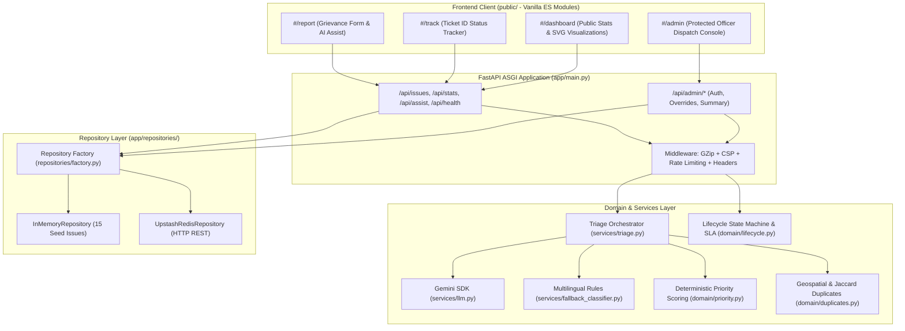

# 🏛️ CivicResolve

> **AI-Powered Citizen Grievance Management, Automated Triage, and Municipal Resolution Platform**

[](https://promptwars-civicsense-gdgocpsg.vercel.app/)
[](https://github.com/alansahai/promptwars-civicsense-gdgocpsg.git)

- 🌐 **Live Deployed App URL**: [https://promptwars-civicsense-gdgocpsg.vercel.app/](https://promptwars-civicsense-gdgocpsg.vercel.app/)
- 📦 **Public GitHub Repository**: [https://github.com/alansahai/promptwars-civicsense-gdgocpsg.git](https://github.com/alansahai/promptwars-civicsense-gdgocpsg.git)
- 🔑 **Demo Officer Password**: `civic-demo-2026` *(displayed on the login card in the portal)*


---

## 📌 Chosen Challenge
**"CivicResolve: AI-Powered Citizen Grievance Management and Resolution"**
Citizens report potholes, overflowing garbage, damaged streetlights, water pipeline bursts, hazardous live wires, sewage leaks, and stray animals. Using **Google Gemini Multimodal AI** combined with a **deterministic priority scoring engine**, CivicResolve automatically understands civic reports in any language, classifies issues into standard municipal taxonomies, computes an explainable 0–100 priority score with SLA targets, identifies potential duplicates, and routes tickets to the appropriate municipal department. A complete end-to-end operational dashboard allows citizens to track issues in real-time and city officials to manage field dispatches and resolutions.

---

## 📑 Table of Contents
1. [Core Features (1:1 Hackathon Mapping)](#-core-features-11-hackathon-mapping)
2. [GenAI Utilization Across the Platform](#-genai-utilization-across-the-platform)
3. [Architecture & System Flow](#-architecture--system-flow)
4. [AI Triage & Deterministic Priority Engine](#-ai-triage--deterministic-priority-engine)
5. [Security & Zero-Trust Hardening](#-security--zero-trust-hardening)
6. [Efficiency & Performance](#-efficiency--performance)
7. [Accessibility (WCAG 2.1 AA)](#-accessibility-wcag-21-aa)
8. [Testing & Quality Assurance](#-testing--quality-assurance)
9. [Quickstart & Local Setup](#-quickstart--local-setup)
10. [Vercel Deployment Step-by-Step](#-vercel-deployment-step-by-step)
11. [Demo Walkthrough Script for Evaluators](#-demo-walkthrough-script-for-evaluators)
12. [Project Structure](#-project-structure)
13. [Assumptions & Limitations](#-assumptions--limitations)

---

## 🌟 Core Features (1:1 Hackathon Mapping)

| # | Expected Feature | CivicResolve Implementation |
|---|---|---|
| **1** | **Citizen Reporting** | Mobile-first 1-page reactive form: optional title (AI-suggested if blank), free-text multilingual description, GPS location capture button + manual landmark text, category dropdown with *"Let AI decide"*, client-side compressed photo upload (JPEG $\le$ 300 KB), and quick-fill sample buttons. |
| **2** | **Gemini Classification** | Structured JSON multimodal triage via Google Gemini (`gemini-2.5-flash` via official `google-genai` SDK), extracting standardized category, urgency tier, community impact (1–5), safety risk boolean, and contextual hazard factors. |
| **3** | **Priority Detection** | Deterministic mathematical scoring (0–100) combining urgency, public impact, safety hazard boosts (+15 pts), critical keywords (+5 to +25 pts), duplicate correlation, and aging escalation. Displays an explainable *"Why this priority?"* breakdown. |
| **4** | **Department Recommendation** | Verifies Gemini's departmental suggestion against the municipal routing matrix (`domain/taxonomy.py`). Automatically routes to Roads & Highways, Solid Waste, Electricity, Water & Drainage, Animal Control, or Environmental Safety. |
| **5** | **Tracking Dashboard** | Public timeline tracker by Ticket ID (`#/track?id=CR-2026-xxxxx`) with audit history, timestamps, officer inspection notes, SLA status, and lazy-loaded photographic evidence. |
| **6** | **Officer Admin Dashboard** | Protected console (`#/admin`) with HMAC session cookies: prioritized grievance queue, detailed AI triage inspector, status transitions (*Reported* $\rightarrow$ *In Progress* $\rightarrow$ *Resolved*), administrative overrides, and Gemini executive weekly summaries. |

---

## 🤖 GenAI Utilization Across the Platform

CivicResolve integrates Google Gemini across seven functional surfaces:

1. **Multimodal Visual Evidence Triage**: Analyzes photos submitted by citizens to determine physical condition (depth of pothole, sparking of cables, volume of garbage spill).
2. **Multilingual Comprehension**: Native understanding of reports in English, தமிழ் (Tamil), and हिन्दी (Hindi) without requiring third-party translation APIs.
3. **Structured Classification**: Produces Pydantic-enforced JSON outputs mapping raw complaints to municipal categories and urgency levels.
4. **Real-time Description Enhancement (`/api/assist`)**: Debounced helper suggesting a concise headline and up to 2 clarifying questions to make citizen reports actionable.
5. **Localized Citizen Acknowledgement**: Generates a polite 2-sentence confirmation in the citizen's native language.
6. **Executive Operational Summaries (`/api/admin/summary`)**: Synthesizes departmental workloads, SLA breaches, and resource pressure points into a 3-paragraph executive briefing for city commissioners.
7. **Heuristic Rule Fallback**: When Gemini API is unavailable or unconfigured, the system automatically falls back to the deterministic keyword rule engine (`services/fallback_classifier.py`), setting `ai_generated: false` for transparency.

---

## 🏗 Architecture & System Flow



---

## ⚡ AI Triage & Deterministic Priority Engine

### Structured Output Schema
```json
{
  "category": "Pothole",
  "suggested_title": "Deep waterlogged pothole near school gate",
  "summary": "2-foot pothole on DB Road causing two-wheelers to slip near school entrance.",
  "detected_language": "en",
  "urgency": "High",
  "public_impact": 4,
  "safety_risk": true,
  "risk_factors": ["near school", "traffic hazard"],
  "recommended_department": "Roads & Highways",
  "confidence": 0.94,
  "reasoning": "Substantial road defect posing imminent slip peril to schoolchildren.",
  "clarifying_questions": ["Is the pothole marked with a safety cone?"],
  "citizen_acknowledgement": "Thank you for reporting this issue. Road repair crews have been dispatched.",
  "photo_observations": "Visible water-filled cavity in asphalt approximately 2 feet in diameter."
}
```

### Deterministic Priority Formula
$$\text{Score} = \text{Base Urgency} (10\text{--}50) + \text{Impact} (4\text{--}20) + \text{Safety Risk} (+15) + \text{Context Boosts} (\le 25) + \text{Duplicates} (\le 10) + \text{Aging} (\le 10)$$

* **Critical ($\ge 80$)**: 8-Hour Resolution SLA
* **High (60–79)**: 24-Hour Resolution SLA
* **Medium (35–59)**: 48-Hour Resolution SLA
* **Low ($< 35$)**: 72-Hour Resolution SLA

---

## 🔒 Security & Zero-Trust Hardening

- **Prompt Injection Neutralization**: Citizen text is strictly delimited within XML boundary tags (`<report><citizen_description>...</citizen_description></report>`), stripped of ASCII control characters, and scanned for jailbreak signatures.
- **Image Upload Security**: Binary magic byte validation (`\xff\xd8\xff` for JPEG, `\x89PNG` for PNG, `RIFF...WEBP` for WebP). Payloads exceeding 300 KB are rejected before server processing.
- **Admin Session Tokens**: Authenticated via constant-time password verification (`hmac.compare_digest`), issuing HMAC-SHA256 signed tokens stored in `httpOnly`, `SameSite=Strict`, `Secure` cookies.
- **CSRF Defense**: All mutating administrative actions (`POST`, `PATCH`, `DELETE`) require custom anti-CSRF headers (`X-Civic-Admin: 1`).
- **Content Security Policy (CSP)**:
  `default-src 'self'; script-src 'self'; style-src 'self' 'unsafe-inline'; img-src 'self' data:; connect-src 'self'; frame-ancestors 'none'; base-uri 'none';`
- **Rate Limiting**: Sliding window in-memory rate limiting by client IP prevents spam submissions and credential brute-forcing.

---

## 🚀 Efficiency & Performance

- **Zero Build Step Frontend**: Pure HTML5, modern CSS, and vanilla ES modules. 0 KB node_modules, instant cold starts.
- **Inline SVG Graphics**: All charts (category breakdown, 14-day trend line/area, locality scatter map) rendered natively in SVG without heavyweight external visualization packages.
- **Lazy Image Storage**: Issue photographs are stored in isolated keys (`photo:{ticket_id}`) and loaded on-demand only on detail views.
- **Single-Pass Aggregations**: Public transparency metrics and workload distribution calculated in a single linear pass over the dataset.
- **Vercel Edge Caching**: Public list and statistics endpoints carry `s-maxage=30, stale-while-revalidate=60` cache headers; admin endpoints enforce `no-store`.

---

## ♿ Accessibility (WCAG 2.1 AA)

- Semantic landmarks (`<header>`, `<nav>`, `<main>`, `<section>`, `<footer>`).
- Visible focus rings (`:focus-visible`) and keyboard-operable modal dialogs with Escape key listeners.
- Screen-reader accessible live regions (`aria-live="polite"`, `aria-live="assertive"`).
- Color contrast compliant; status and priority never conveyed by color alone (badges combine text, icons, and shapes).
- Accessibility toggles: High Contrast Mode (`.high-contrast`) and Large Text Mode (`A+`).
- Multilingual interface switcher supporting English, தமிழ் (Tamil), and हिन्दी (Hindi).

---

## 🧪 Testing & Quality Assurance

CivicResolve includes a 46-test test suite covering domain logic, lifecycle transitions, fallback classification, image security, authentication, and API endpoints:

```bash
# Run the complete test suite
pytest -v

# Run code style and lint verification
ruff check .
```

### Coverage Highlights
- `test_priority.py`: Baseline urgency mapping, context boosts, aging escalation, clamping.
- `test_duplicates.py`: Haversine geodesic distance, Jaccard token overlap, active status filters.
- `test_lifecycle.py`: State machine transition validation, SLA deadline and breach computation.
- `test_fallback_classifier.py`: Multilingual keyword triage across English, Tamil, and Hindi.
- `test_safety.py`: Prompt injection pattern detection and control character stripping.
- `test_image_utils.py`: Magic byte validation and 300 KB size enforcement.
- `test_auth.py`: Constant-time verification, session token creation, tampering rejection.
- `test_api_public.py` & `test_api_admin.py`: End-to-end API workflows.

---

## 💻 Quickstart & Local Setup

### Prerequisites
- Python 3.11+
- Git

### 1. Clone & Install
```bash
git clone <YOUR_REPO_URL>
cd civicresolve
pip install -r requirements-dev.txt
```

### 2. Environment Variables (Optional)
CivicResolve runs out-of-the-box with **NO environment variables**:
```bash
cp .env.example .env
```
*(Optional: Add `GEMINI_API_KEY` for live Google Gemini Flash multimodal triage, or leave blank to run in demo fallback mode).*

### 3. Run Locally
```bash
uvicorn app.main:app --reload --port 8000
```
Open your browser to: **`http://localhost:8000`**

### 4. Execute Automated Smoke Test
```bash
python scripts/smoke_test.py http://127.0.0.1:8000
```

---

## ☁️ Vercel Deployment Step-by-Step

CivicResolve is pre-configured for instant deployment on **Vercel Hobby**:

1. **Import Repository**: In your Vercel Dashboard, click **"Add New Project"** and select your GitHub repository.
2. **Framework Preset**: Select **"Other"**.
3. **Environment Variables**:
   - `GEMINI_API_KEY`: Your Google Gemini API Key *(Optional, falls back to heuristic engine if omitted)*.
   - `GEMINI_MODEL`: `gemini-2.5-flash` *(Default)*.
   - `ADMIN_PASSWORD`: Custom officer password *(Defaults to `civic-demo-2026` in demo mode)*.
   - `TOKEN_SECRET`: A 32+ character secret string for HMAC tokens.
   - `CITY_NAME`: Municipality name *(Default: `Coimbatore`)*.
   - `UPSTASH_REDIS_REST_URL` & `UPSTASH_REDIS_REST_TOKEN`: Upstash Redis credentials *(Optional: defaults to InMemory store)*.
4. **Deploy**: Click **Deploy**. Vercel will bundle the Python ASGI function via `api/index.py` and serve static assets directly from `public/`.

---

## 🎬 Demo Walkthrough Script for Evaluators

1. **Submit a Sample Report**:
   - Navigate to `#/report`.
   - Click the quick sample button **"🚧 Pothole near School"**.
   - Notice the description, title, category, and GPS coordinates autofill.
   - Click **"Submit Civic Report"**.
   - Review the confirmation card showing: **Ticket ID**, **AI-Detected Category**, **Priority Assessment**, **Resolution SLA**, and the **"Why this priority score?"** factors.
2. **Track the Issue**:
   - Click **"Track This Issue"** (or go to `#/track?id=...`).
   - Observe the live investigation status and the **Resolution Timeline**.
3. **Inspect the Public Dashboard**:
   - Click **"Public Dashboard"** in the navigation.
   - Review the 5 summary stat cards, the **Category Breakdown SVG chart**, the **14-Day Trend SVG chart**, and the **Locality Scatter Map**.
4. **Officer Portal & Status Progression**:
   - Click **"Officer Portal"** (`#/admin`).
   - Use the prefilled demo credentials:
     - **Demo Password**: `civic-demo-2026` *(displayed on the login card)*.
   - Click **"Login to Dispatch Console"**.
   - Review the **Departmental Workload Distribution** and **Overdue SLA alerts**.
   - Find your submitted issue in the table and click **"Manage"**.
   - Update the status from `Reported` $\rightarrow$ `In Progress` $\rightarrow$ `Resolved`, add an officer note, and click **"Save Updates"**.
   - Click **"✨ Generate AI Operational Summary"** to view a Gemini-generated operational briefing.

---

## 📂 Project Structure

```text
civicresolve/
├── api/
│   └── index.py                  # Vercel Serverless ASGI entrypoint
├── app/
│   ├── config.py                 # Pydantic-settings configuration with HMAC token derivation
│   ├── main.py                   # FastAPI app, GZip, rate-limiting, and domain exception handlers
│   ├── schemas.py                # Strict Pydantic models (extra="forbid")
│   ├── security_headers.py       # Single source of truth for CSP and baseline security headers
│   ├── api/
│   │   ├── admin_routes.py       # Protected officer endpoints & audit overrides
│   │   ├── deps.py               # Authentication, CSRF guard, and Vercel client IP extraction
│   │   └── public_routes.py      # Citizen submission, tracking, and assist endpoints
│   ├── domain/
│   │   ├── duplicates.py         # Pure Haversine & Jaccard duplicate detection
│   │   ├── errors.py             # Typed domain exception hierarchy
│   │   ├── lifecycle.py          # Pure status state machine & SLA tracker
│   │   ├── models.py             # Core domain models & dataclasses
│   │   ├── priority.py           # Pure deterministic priority scoring engine
│   │   └── taxonomy.py           # Municipal categories & department routing
│   ├── repositories/
│   │   ├── base.py               # IssueRepository Protocol interface
│   │   ├── factory.py            # Storage engine selection factory
│   │   ├── memory.py             # Thread-safe in-memory store
│   │   ├── seed.py               # Deterministic seed data builder (<25 lines)
│   │   ├── seed_data.py          # Declarative SeedSpec table with 15 realistic grievances
│   │   └── upstash.py            # Upstash Redis REST HTTP client
│   └── services/
│       ├── analytics_service.py  # Department workload & SLA breach analytics
│       ├── auth.py               # Constant-time HMAC session manager
│       ├── fallback_classifier.py# Multilingual heuristic rule triage
│       ├── image_utils.py        # Magic byte validation & size caps
│       ├── issue_service.py      # Core grievance lifecycle use-cases
│       ├── llm.py                # Google Gemini SDK multimodal wrapper
│       ├── safety.py             # Input sanitization & prompt injection guard
│       ├── stats_service.py      # Public statistics & 14-day trend calculation
│       └── triage.py             # End-to-end triage orchestrator
├── docs/
│   ├── ARCHITECTURE.md           # In-depth architectural specification
│   └── screenshots/              # Automated Playwright test execution artifacts
├── public/
│   ├── favicon.svg               # SVG municipal seal
│   ├── index.html                # Semantic accessible single-page shell
│   ├── styles.css                # Mobile-first accessible styling system
│   └── js/
│       ├── api.js                # HTTP client with CSRF protection
│       ├── app.js                # Application bootstrapper
│       ├── dom.js                # Safe DOM element builder (zero innerHTML)
│       ├── i18n.js               # English, Tamil, Hindi dictionary
│       ├── router.js             # Client hash router (#/report, #/track, etc.)
│       ├── components/           # Reusable SVG charts, header, banner, modals
│       └── views/                # Report, Track, Dashboard, Admin views
├── scripts/
│   ├── smoke_test.py             # Automated end-to-end integration test
│   └── verify_ui.py              # Playwright browser verification script
├── tests/                        # 68 comprehensive unit, integration & mock tests
│   ├── test_code_quality.py      # AST static analysis enforcing function size and docstrings
│   ├── test_repository_upstash.py# Respx mock suite for Upstash Redis REST client
│   ├── test_routes_coverage.py   # Route edge cases, client IP, and CSP parity
│   └── test_services_coverage.py # Service lifecycle, fallback rules, and Gemini mocks
├── .env.example                  # Environment variable reference
├── .github/workflows/ci.yml      # GitHub Actions CI workflow (Ruff, Mypy, Pytest)
├── .gitignore                    # Git exclusion rules
├── .vercelignore                 # Production build exclusion rules
├── CONTRIBUTING.md               # Engineering guidelines and contribution guide
├── Makefile                      # Developer shortcut commands
├── pyproject.toml                # Unified Ruff, Pytest, Coverage, and Mypy configuration
├── requirements.txt              # Pinned lightweight runtime dependencies
├── requirements-dev.txt          # Development, testing, and linting tools
└── vercel.json                   # Vercel rewrites, CSP, and caching policies
```

---

## 🏆 Code Quality & Engineering Standards

- **Strict Function Length Limit**: Every function and method in `app/` and `public/js/` is restricted to $\le 40$ lines of executable code (enforced by AST static analysis in `tests/test_code_quality.py`).
- **Comprehensive Docstrings**: Every public module, class, function, and method contains a clear docstring documenting behavior and arguments.
- **Zero innerHTML in Frontend Client**: The entire UI is built with a safe DOM construction helper (`public/js/dom.js`), completely eliminating DOM-XSS risks and template injection vulnerabilities.
- **Single Source of Truth for Security Headers**: Content Security Policy and baseline HTTP headers are defined once in `app/security_headers.py` and verified by automated parity testing against `vercel.json`.
- **Test Coverage & Static Typing**: The test suite encompasses 68 tests achieving **93.4%** code coverage with strict threshold enforcement (`--cov-fail-under=90`).
- **Linter & Type Rigor**: Governed by strict Ruff rules (`E,F,I,B,UP,SIM,C90,PL,RET,ARG,PTH,S`) with `mccabe max-complexity=10` and `PLR0915 max-statements=30`.

---

## ⚠️ Assumptions & Limitations

1. **Demo In-Memory Storage**: By default, CivicResolve uses an in-memory repository pre-seeded with 15 realistic grievances in Coimbatore. Data resets if the local process terminates or upon serverless cold start. For persistent production, configure `UPSTASH_REDIS_REST_URL` and `UPSTASH_REDIS_REST_TOKEN`.
2. **AI Fallback by Design**: In environments without a valid `GEMINI_API_KEY`, the application automatically activates its multilingual heuristic rule engine. All features (categorization, priority scoring, department routing, SLA calculation) continue functioning deterministically.
3. **Officer Override Capability**: Recognizing that GenAI models can occasionally misclassify nuanced civic grievances, CivicResolve provides an **Administrative Override** mechanism in the Officer Portal to adjust category, priority, or department assignments with an audit trail.
4. **Locality Map Representation**: To ensure maximum speed and zero third-party map library vulnerabilities, the locality map is rendered as an inline SVG coordinate scatter plot centered around municipal coordinates.
