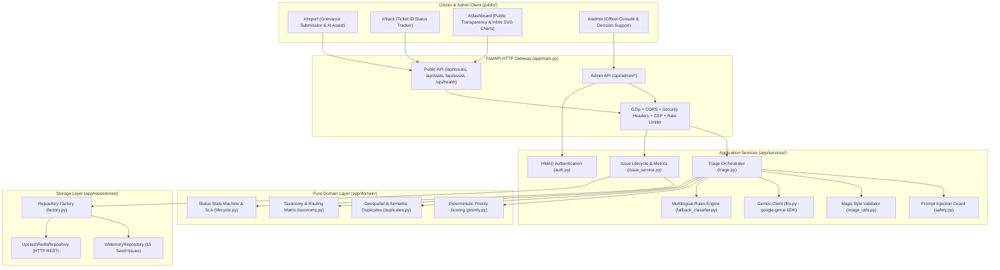
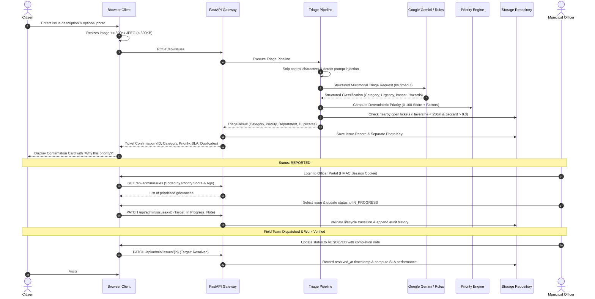

# CivicResolve Technical Architecture & System Specification

## 1. System Overview & Philosophy

**CivicResolve** is an AI-powered municipal grievance management and resolution platform. It is engineered with a strict **"Explainable, Grounded, and Resilient"** design philosophy:

1. **AI as an Assistant, Not an Oracle**: GenAI assesses unstructured natural language and attached photographic evidence, but critical municipal routing and prioritization decisions are governed by transparent, deterministic domain rules.
2. **Zero-Configuration Fallback (Out-of-the-box Execution)**: The platform functions immediately upon cloning with no environment variables. If Google Gemini API credentials or cloud storage are missing, the system gracefully shifts to in-memory storage and multilingual heuristic classification without degrading core capabilities.
3. **Thin Routes, Rich Domain**: All business logic (priority calculation, SLA tracking, duplicate correlation, lifecycle validation) resides in pure domain functions and services, making endpoints minimal and unit testing exhaustive.
4. **Zero-Dependency Frontend**: Static HTML, modern CSS, and vanilla ES modules with inline SVG visualizations. No Node build pipeline, no external CDN dependencies, and guaranteed WCAG 2.1 AA accessibility.

---

## 2. Architecture Diagram



---

## 3. End-to-End Request Flow (Submission to Resolution)



---

## 4. Deterministic Priority Engine (`app/domain/priority.py`)

Rather than letting the LLM arbitrarily guess a priority score, CivicResolve blends the LLM's urgency evaluation with an explainable, deterministic mathematical scoring model:

$$\text{Priority Score} = \text{Base Urgency} + \text{Impact} + \text{Safety Hazard} + \sum \text{Risk Boosts} + \text{Community Volume} + \text{Aging}$$

| Factor | Points | Evaluation Mechanism |
|---|---|---|
| **Urgency Tier** | 10 to 50 pts | Critical (50), High (35), Medium (20), Low (10) |
| **Public Impact** | 4 to 20 pts | $\text{Impact Level (1-5)} \times 4$ points |
| **Safety Risk** | +15 pts | Imminent danger or biological contamination flagged |
| **Context Risk Boosts** | +5 to +25 pts | Keywords detected: Live Wire (+20), Sparking (+15), Open Manhole (+20), School Proximity (+12), Hospital Proximity (+12), Main Road (+10), Drinking Water (+15) |
| **Community Multiplier** | +3 to +10 pts | Correlated open duplicate reports nearby (+3 pts per duplicate) |
| **Aging Escalation** | +2 to +10 pts | Unresolved open days (+2 pts per day) |

**Total Priority Score (5 to 100)** maps to standardized Municipal SLAs:
- **81 - 100 (Critical)**: 8 Hours Resolution SLA (Emergency dispatch)
- **61 - 80 (High)**: 24 Hours Resolution SLA
- **36 - 60 (Medium)**: 48 Hours Resolution SLA
- **5 - 35 (Low)**: 72 Hours Resolution SLA

Every factor contributing points is packaged into an explainable `priority_breakdown` list displayed to the citizen as **"Why this priority?"**.

---

## 5. Duplicate Detection Engine (`app/domain/duplicates.py`)

Civic reports are frequently submitted by multiple citizens witnessing the same physical defect. CivicResolve prevents departmental duplicate dispatch using a pure, dual-metric duplicate engine:

1. **Geospatial Proximity**: Great-circle geodesic distance calculated via the Haversine formula:
   $$d = 2R \arcsin\left(\sqrt{\sin^2\left(\frac{\Delta\phi}{2}\right) + \cos(\phi_1)\cos(\phi_2)\sin^2\left(\frac{\Delta\lambda}{2}\right)}\right)$$
   Matches within a **250-meter radius** are evaluated.
2. **Semantic Text Overlap**: Normalized token Jaccard similarity coefficient:
   $$J(A, B) = \frac{|A \cap B|}{|A \cup B|}$$
   After stripping stop words and punctuation in English, Tamil, and Hindi.
3. **Correlation Logic**:
   - Geodesic distance $\le 250\text{m}$ + Same Category + Jaccard similarity $\ge 0.20$.
   - Geodesic distance $\le 250\text{m}$ + High textual overlap ($\ge 0.45$).
   - High textual overlap in the same category ($\ge 0.35$) even when GPS is disabled.

---

## 6. Multimodal Gemini Triage & Resilient Fallback

When `GEMINI_API_KEY` is present, CivicResolve invokes Google Gemini via the official `google-genai` SDK (`gemini-2.5-flash`):
- **Multimodal Understanding**: If a photo is attached, Gemini analyzes physical depth, broken infrastructure, or hazardous cable positions.
- **Strict Data Envelope**: User input is wrapped inside `<report><citizen_description>...</citizen_description></report>` tags to prevent prompt injection.
- **Structured JSON Schema**: Guaranteed schema conformance via Pydantic model response definition.
- **Fail-Safe Timeout**: Enforces an 8-second request budget with 1 retry. On timeout, quota exhaustion, or parse failure, it automatically triggers the **Multilingual Heuristic Classifier** (`services/fallback_classifier.py`) and sets `ai_generated: false` so that the citizen and officers see a transparent `"Heuristic Rule Triaged"` label.

---

## 7. Security & Hardening Architecture

1. **Input Validation**: Strict Pydantic models with `extra="forbid"`, text length caps (4,000 characters), and geographic coordinate bounds checks.
2. **Magic Byte Image Verification**: Prevents malicious file uploads by verifying true binary headers (`\xff\xd8\xff` for JPEG, `\x89PNG` for PNG, `RIFF...WEBP` for WebP). Rejects payloads $> 300\text{ KB}$.
3. **Session Security**: Admin session tokens are signed using HMAC-SHA256 and stored in `httpOnly`, `SameSite=Strict`, `Secure` cookies with constant-time password comparisons (`hmac.compare_digest`).
4. **CSRF Protection**: All state-modifying requests (`POST`, `PATCH`, `DELETE`) require custom anti-CSRF headers (`X-Civic-Admin: 1` and `X-Requested-With: XMLHttpRequest`).
5. **Content Security Policy (CSP)**:
   ```http
   Content-Security-Policy: default-src 'self'; script-src 'self'; style-src 'self' 'unsafe-inline'; img-src 'self' data:; connect-src 'self'; frame-ancestors 'none'; base-uri 'none';
   ```
6. **Rate Limiting**: Sliding window in-memory rate limiting by client IP (20 submissions/5 min, 6 login attempts/5 min).
7. **PII Minimization**: No phone numbers or emails collected. Coordinates rounded to 3 decimal places in logs to safeguard citizen privacy.

---

## 8. Storage Engine & Repository Pattern

CivicResolve abstracts persistence behind the `IssueRepository` Protocol (`app/repositories/base.py`):
1. **InMemoryRepository (`app/repositories/memory.py`)**:
   - Thread-safe in-memory store initialized with 15 deterministic realistic grievances in Coimbatore.
   - Separate image dictionary for lazy loading.
   - Selected automatically when Upstash credentials are not set.
2. **UpstashRedisRepository (`app/repositories/upstash.py`)**:
   - Cloud persistence via Upstash Redis REST API over async `httpx`.
   - Zero native C-extension database drivers, perfectly suited for serverless Vercel environments.
   - Images stored in distinct Redis keys (`photo:{ticket_id}`) to minimize bandwidth during listing operations.
